I used to make documentary films, I studied philosophy, and now I write free software.

I work with [Dyne.org](https://dyne.org) and [Forkbomb](https://forkbomb.eu) on open-source digital identity and open hardware, and I am the author of [Sergio](https://github.com/phoebus-84/video-studio), a studio for making video with AI agents.

## Sergio

**Make episode twenty as good as episode one.**

A local, open-source production system for video made with AI agents. The agent (Claude Code or Pi) writes, generates and edits. The studio keeps what the agent forgets: every attempt, what each paid call cost, the licence of each borrowed asset, each decision the operator approved. A fix at second 47 leaves everything else alone.

[Repository](https://github.com/phoebus-84/video-studio) · [Guides and recipes](https://phoebus-84.github.io/video-studio-site/) · [Films made with it](https://phoebus-84.github.io/video-studio-site/examples)

<!-- CHANNELS — uncomment when the first channel repos are presentable.

## Channels

Series made with Sergio. Each one publishes its scripts, visuals and sound.

| Channel | What it is | Source |
|---|---|---|
| [Name](https://youtube.com/@handle) | One line | [repo](https://github.com/phoebus-84/repo) |

-->

## Free software

Since 2022, with Dyne.org and Forkbomb.

| | |
|---|---|
| [DIDroom wallet](https://github.com/ForkbombEu/wallet) and [verifier](https://github.com/ForkbombEu/verifier) | Mobile apps for holding and verifying digital credentials, on iOS and Android. Main contributor to both. |
| [didroom-components](https://github.com/ForkbombEu/didroom-components) | The web components those apps are built from. |
| [Credimi](https://credimi.io) | Conformance and interoperability testing for EUDI wallets, issuers and verifiers. |
| [Interfacer](https://interfacerproject.eu) | A platform for sharing open-source hardware designs. Main contributor to its [GUI](https://github.com/interfacerproject/interfacer-gui); now working on its marketplace and authorisation. |
| [frei0r](https://github.com/dyne/frei0r) | Two video filters: `slitscan0r`, a slit scan with a mode after the Star Gate sequence of *2001*, and `motiondiff0r`, temporal frame differencing. |

## What I work with

TypeScript every day, with Svelte and SvelteKit. React and Next.js on Interfacer, Vue before that. Go on the server. Mobile with Ionic and Capacitor, on iOS and Android. Python for model workers and pipelines. C when a video filter needs it, FFmpeg underneath. n8n when a workflow is quicker to draw than to write.

Most of these I did not know when the project that needed them began: React in 2022, Svelte in 2023, mobile in 2024, Go in 2025, C and agent harnesses in 2026. Learning the next one is the part of the job I like most.

I am open to new work, remote, contract or employment. Write to [ennio@dyne.org](mailto:ennio@dyne.org).

The picture at the top is this account's contribution calendar put through the same slit scan as `slitscan0r`. [A script](scripts/stargate.mjs) redraws it every night.
